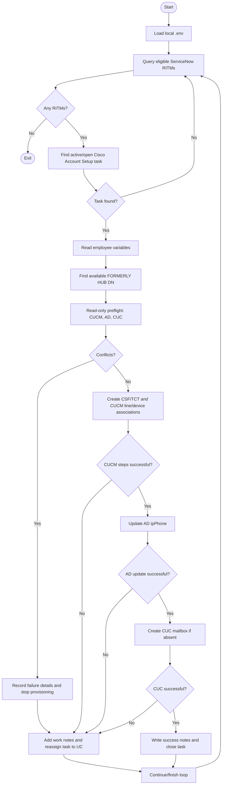

# Architecture and execution flow

## High-level path

## Systems and responsibilities

| Component | Role | Main operations |
|---|---|---|
| ServiceNow | Work queue and request data | Query request items/tasks, read variables, update notes/state/assignment |
| CUCM AXL | Call-control provisioning | Select a reusable DN, create CSF/TCT devices, update lines, associate devices/users |
| Active Directory | Directory metadata | Read user `ipPhone`; update that attribute to the selected extension |
| Unity Connection CUPI/VMREST | Voicemail provisioning | Check mailbox state and create mailbox using the configured template |
| Local environment | Runtime configuration | Load credentials from `.env` and locate the AXL WSDL |

## Preflight intent

The preflight checks are intended to detect conflicting state before writes. It checks the selected extension and related CUCM objects, the AD `ipPhone` value, and whether a CUC mailbox exists with a matching DTMF access ID. A preflight pass is not a transaction guarantee: state can change between checks and writes, and downstream operations can still fail.

## Cross-system consistency

CUCM, AD, CUC, and ServiceNow do not share a transaction. If an operation succeeds in one system and a later step fails, the script may leave a partial result. Use the reconciliation procedure in [`RECOVERY.md`](RECOVERY.md); do not assume that retrying the whole request is idempotent.
